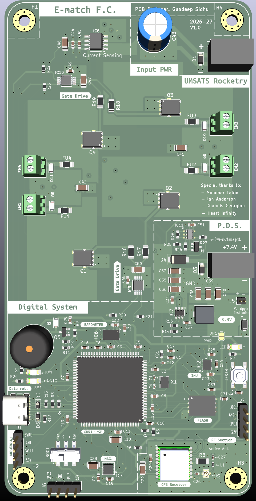
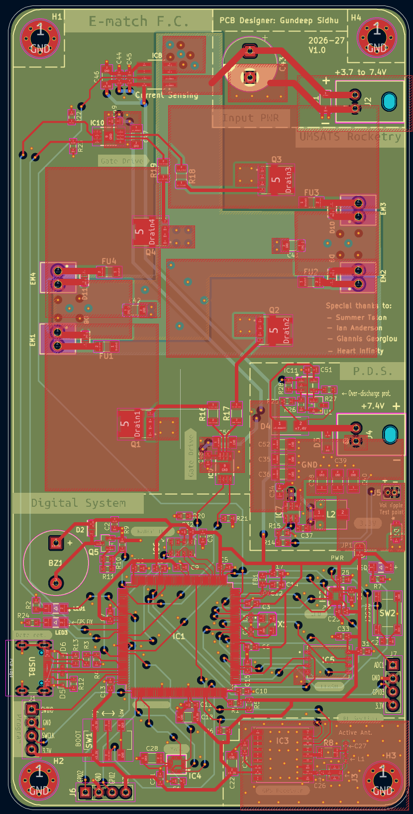

# SRAD_V2

This repository contains the schematic, PCB, and supporting design files for the Student Researched and Designed (SRAD) rocket avionics computer.

  
  

## Project Structure

- **SRAD_V2.kicad_pro** — Main KiCad project file
- **SRAD_V2.kicad_sch** — Schematic file containing the full circuit design.
- **SRAD_V2.kicad_pcb** — PCB layout file for board routing and placement.
- **SRAD_V2-backups/** — Automatically generated backup files created by KiCad.
- **Custom E-cad Models/** — Custom or project-specific component symbols, footprints and 3D models used in the PCB design.

---

## System Overview

The schematic is organized into blocks for clarity:

- **Power Delivery System (PDS)**  
  Handles voltage regulation and distribution. Goal is to provide stable power to all avionics subsystems.

- **E-match Firing Circuit (EMFC)**  
  Provides quick burst of high current to e-matches via four separate channels. It also includes short circuit protection and various other safety features.

- **MCU (Microcontroller Unit)**  
  Central controller that interfaces with all sensors and peripherals. Will run the flight software and handle communication.

- **IMU for Sensing Motion and Temperature** -> LSM6DSV80XTR

- **Magnetometer** -> MMC5983MA

- **Barometer** -> MS5607-02BA

- **GPS** -> MAX-M10S

- **Data Storage** -> AT25SFQ64

---
